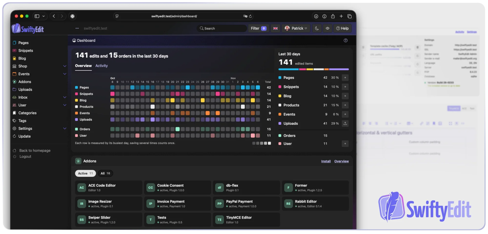

<p align="center">
  
</p>

<p align="center">
  <strong>Ein schlankes, selbst gehostetes PHP-CMS für Websites, Blogs, Shops und Events – alles in einem kleinen Core.</strong>
</p>

<p align="center">
  <a href="https://packagist.org/packages/swiftyedit/swiftyedit"></a>
  
  <a href="license.txt"></a>
  <a href="https://github.com/SwiftyEdit/SwiftyEdit/actions/workflows/phpstan.yml"></a>
  <a href="https://crowdin.com/project/swiftyedit"></a>
</p>

<p align="center">
  <a href="https://swiftyedit.dev/de/dokumentation/">Dokumentation</a> ·
  <a href="https://swiftyedit.dev/de/download/">Download</a> ·
  <a href="ROADMAP.md">Roadmap</a> ·
  <a href="CHANGELOG.md">Changelog</a> ·
  <a href="README.md">English</a> ·
  <a href="README.es.md">Español</a>
</p>



## Warum SwiftyEdit?

Die meisten Websites kleiner Unternehmen benötigen mehr als nur klassische Inhaltsseiten: einen News-Bereich, 
einen kleinen Shop oder die Möglichkeit, Events inklusive Gästeliste zu verwalten. 
Bei vielen CMS bedeutet das, Plugins unterschiedlicher Anbieter miteinander zu kombinieren. 
SwiftyEdit geht einen anderen Weg: **Seiten, Blog, Shop und Events** sind bereits im Core integriert. 
Alles aus einem Guss, ohne unnötigen Ballast.

- **Datenbank ohne Einrichtung** – läuft direkt mit SQLite, kein Datenbankserver nötig. Natürlich funktioniert auch MySQL.
- **Alles in einem** – Seiten, Snippets, Blog, Shop (inkl. digitaler Produkte) und Events mit Reservierungen.
- **Gebaut für die DSGVO** – von Anfang an auf den europäischen Datenschutz ausgelegt,
  ohne Tracking und ohne externe Dienste. [Mehr zum Datenschutz](#datenschutz-von-anfang-an)
- **Updates per Klick** – der eingebaute Updater hält deine Installation aktuell.
- **Moderner, gepflegter Code** – PHP 8.3+, HTMX, Twig im Backend, Smarty-Themes im Frontend,
  PHPStan Level 5 und Playwright-End-to-End-Tests.
- **Erweiterbar** – Themes, Plugins und ein Hook-System für Backend, Frontend und globale Ereignisse.
- **Headless-fähig** – eine REST-API mit eingeschränkten API-Keys lässt andere Anwendungen deine
  Inhalte lesen. Schreibzugriff steht [auf der Roadmap](ROADMAP.md#later) – Hilfe ist willkommen!
- **In über 10 Sprachen übersetzt** – von der Community über Crowdin.

## Funktionen

| Modul | Was du bekommst |
|---|---|
| **Seiten** | Seitenbaum, Seitentypen, mehrere Editoren (TinyMCE, ACE), SEO-Metadaten, XML-Sitemap |
| **Snippets** | Wiederverwendbare Textbausteine für Seiten, Beiträge, Produkte und E-Mails |
| **Blog** | Nachrichten, Bilder, Galerien, Videos, Links und Downloads |
| **Shop** | Produkte und Varianten, Preisgruppen, Eigenschaften, Optionen, Filter, Bestellverwaltung, digitale Produkte, Zahlungs-Plugins |
| **Events** | Veranstaltungen mit Reservierungen und Gästelisten |
| **Benutzer** | Konten, Gruppen und Rechte, Zwei-Faktor-Authentifizierung für das Backend |
| **Uploads** | Medienverwaltung für Bilder und Dateien |
| **API** | REST-API (`/api/v1/`) mit fein abgestuften API-Keys – heute lesend, Schreibzugriff geplant |

## Datenschutz von Anfang an

Datenschutz ist bei SwiftyEdit kein nachträglicher Zusatz, sondern von Anfang an Teil des Konzepts. 
Die Architektur ist auf einen datenschutzbewussten Betrieb und die Anforderungen der 
europäischen Datenschutz-Grundverordnung (DSGVO) ausgelegt.

- **Deine Daten bleiben auf deinem Server.** Mit SQLite liegen Inhalte, Benutzer und Bestellungen
  als Dateien auf deinem eigenen Webspace – keine externe Datenbank, kein Cloud-Dienst.
- **Kein Tracking, keine externen Ressourcen.** Core und Standard-Theme laden keine Schriften, Skripte
  oder Styles von CDNs oder Drittanbietern und enthalten keine Analyse-Tools.
- **Updates aus Deutschland.** Das Backend kontaktiert nur swiftyedit.net – für Updates und den
  Plugin-Katalog. Diese Server stehen in Deutschland.
- **Datensparsamkeit eingebaut.** Das Log enthält keine E-Mail-Adressen, Einträge werden
  nach 90 Tagen gelöscht, und beim Löschen eines Kontos verschwindet auch der Name aus dem Log.
  Anonyme Bewertungen und Bestätigungen in Gästelisten speichern nie die IP-Adresse selbst, sondern
  nur einen mit geheimem Schlüssel gebildeten Hash, der nach 90 Tagen entfernt wird.
- **Recht auf Löschung.** Benutzerkonten lassen sich im Backend löschen oder von Benutzern selbst im
  Profil. Bestellungen bleiben wegen gesetzlicher Aufbewahrungspflichten erhalten, Kommentare werden
  anonymisiert oder gelöscht.

Die Verantwortung für Datenschutz und rechtssicheren Betrieb liegt natürlich weiterhin beim Webseiten-Betreiber. 
SwiftyEdit unterstützt dich dabei, die technischen Voraussetzungen für einen datenschutzbewussten Betrieb zu schaffen.

## Schnellstart

**Voraussetzungen:** PHP 8.3+, Apache mit `mod_rewrite` und PDO, SQLite oder MySQL 5.6+

1. **SwiftyEdit holen** – [aktuelle Version herunterladen](https://swiftyedit.dev/de/download/) oder per Composer:
   ```bash
   composer create-project swiftyedit/swiftyedit
   ```
2. **Die Domain auf das Verzeichnis `/public/` zeigen lassen.** Das ist seit Version 2.0 Pflicht.
3. **`/install.php` im Browser aufrufen** und dem Installer folgen. Wähle SQLite, wenn du keine
   Datenbank einrichten möchtest.

Das war's. Die ausführliche Anleitung steht in der [Dokumentation](https://swiftyedit.dev/de/dokumentation/).

## Für Entwickler

SwiftyEdit lässt sich leicht erweitern. Ein Plugin ist ein Ordner in `plugins/` mit einem
`info.json`-Manifest und einer `index.php`. Über Hooks reagieren Plugins auf das, was im Backend
und Frontend passiert:

```php
// plugins/my-plugin/hooks-global/order-paid.php
se_add_global_hook('order.paid', function (array $context): void {
    // runs when an order is marked as paid — manually in the backend
    // or automatically by a payment plugin
    $orderId = $context['order_id'];
});
```

- [Entwickler-Dokumentation](https://swiftyedit.dev/de/dokumentation/) – Themes, Templates, Plugins, Hooks und API
- Frontend-Themes nutzen **Smarty**, das Backend **Twig** und **HTMX**
- Prüfungen ausführen: `composer analyse` (PHPStan) und `npm test` (Playwright)

## Mitmachen

Beiträge jeder Größe sind willkommen – Bugfixes, Features, Dokumentation und Übersetzungen.

- Lies den [Leitfaden für Beiträge](CONTRIBUTING.md) und unseren [Verhaltenskodex](CODE_OF_CONDUCT.md).
- Du suchst eine Aufgabe? Schau in die [Roadmap](ROADMAP.md#later) – mit 🤝 markierte Punkte,
  etwa der Schreibzugriff für die REST-API, eignen sich gut zum Einstieg.
- Du planst eine größere Änderung? Bitte [eröffne vorher ein Issue](https://github.com/SwiftyEdit/SwiftyEdit/issues), damit wir uns abstimmen können.
- Du möchtest übersetzen? Mach mit beim [Crowdin-Projekt](https://crowdin.com/project/swiftyedit).
- Du hast eine Sicherheitslücke gefunden? Bitte folge unserer [Sicherheitsrichtlinie](SECURITY.md), statt ein öffentliches Issue zu eröffnen.

### Hilfe abseits vom Code

SwiftyEdit wird im Wesentlichen von einer Person entwickelt, und neben dem Code gibt es viel zu tun.
Wenn dir etwas davon Spaß macht, freuen wir uns, von dir zu hören:

- **Testen** – neue Versionen vor dem Release installieren und melden, was nicht funktioniert
- **Schreiben** – Blogbeiträge, Tutorials und Verbesserungen an der Dokumentation
- **Community & Repository** – Issues sortieren, Fragen beantworten, neue Mitwirkende begrüßen

Vorherige Beiträge sind nicht nötig. Jede Rolle beginnt mit einer kleinen ersten Aufgabe, und du
kannst nach und nach mehr Verantwortung übernehmen. [Mehr erfahren und Kontakt aufnehmen](https://github.com/SwiftyEdit/SwiftyEdit/issues?q=is%3Aissue+is%3Aopen+label%3A%22help+wanted%22).

Wenn dir SwiftyEdit gefällt, hilft ein ⭐ auf GitHub anderen, es zu finden.

## Lizenz

SwiftyEdit ist freie Software, lizenziert unter der [GNU General Public License v3.0 oder später](license.txt).
