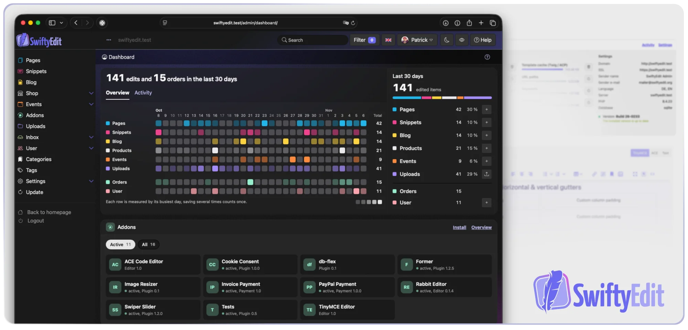

<p align="center">
  
</p>

<p align="center">
  <strong>A lightweight, self-hosted PHP CMS for websites, blogs, shops and events — all in one small core.</strong>
</p>

<p align="center">
  <a href="https://packagist.org/packages/swiftyedit/swiftyedit"></a>
  
  <a href="license.txt"></a>
  <a href="https://github.com/SwiftyEdit/SwiftyEdit/actions/workflows/phpstan.yml"></a>
  <a href="https://crowdin.com/project/swiftyedit"></a>
</p>

<p align="center">
  <a href="https://swiftyedit.dev/en/documentation/">Documentation</a> ·
  <a href="https://swiftyedit.dev/en/download/">Download</a> ·
  <a href="ROADMAP.md">Roadmap</a> ·
  <a href="CHANGELOG.md">Changelog</a> ·
  <a href="README.de.md">Deutsch</a> ·
  <a href="README.es.md">Español</a>
</p>



## Why SwiftyEdit?

Most small business sites need more than pages: a news section, a few products to sell,
an event with a guest list. With many CMSs that means stacking plugins from different vendors.
SwiftyEdit ships **pages, blog, shop and events in one core** — and stays small enough to understand.

- **Zero-config database** — runs on SQLite out of the box, no database server needed. MySQL works too.
- **All-in-one** — pages, snippets, blog, shop (incl. digital products) and events with reservations.
- **Built for GDPR** — designed around European data protection from the start,
  no tracking, no external services. [More about privacy](#privacy-by-design)
- **One-click updates** — the built-in updater keeps your installation current.
- **Modern, maintained codebase** — PHP 8.3+, HTMX, Twig in the backend, Smarty themes in the frontend,
  PHPStan level 5 and Playwright end-to-end tests.
- **Extendable** — themes, plugins and a hook system for backend, frontend and global events.
- **Headless-ready** — a REST API with scoped API keys lets other apps read your content.
  Write access is [on the roadmap](ROADMAP.md#later) — help is welcome!
- **Translated into 10+ languages** — community-driven via Crowdin.

## Features

| Module | What you get |
|---|---|
| **Pages** | Page tree, usage types, multiple content editors (TinyMCE, ACE), SEO meta data, XML sitemap |
| **Snippets** | Reusable text blocks for pages, posts, products and e-mails |
| **Blog** | Messages, images, galleries, videos, links and downloads |
| **Shop** | Products and variants, price groups, features, options, filters, order management, digital products, payment plugins |
| **Events** | Event management with reservations and guest lists |
| **Users** | Accounts, groups and permissions, two-factor authentication for the backend |
| **Uploads** | Media management for images and files |
| **API** | REST API (`/api/v1/`) with granular, scoped API keys — read access today, write access planned |

<!-- TODO: add 2–3 more screenshots here (page editor, shop product, frontend theme) -->

## Privacy by design

At SwiftyEdit, privacy is not an afterthought but part of the concept from the start.
The architecture is designed for privacy-conscious operation and the requirements of the
European General Data Protection Regulation (GDPR).

- **Your data stays on your server.** With SQLite, content, users and orders live in files on your
  own webspace — no external database, no cloud service.
- **No tracking, no external resources.** The core and the default theme load no fonts, scripts or
  styles from CDNs or third parties, and contain no analytics.
- **Updates from Germany.** The backend only contacts swiftyedit.net — for updates and the plugin
  catalog. These servers are located in Germany.
- **Data minimization built in.** The log contains no e-mail addresses, entries are deleted
  after 90 days, and deleting an account also removes its name from the log.
  Anonymous votes and guest list confirmations never store the IP address itself, only a keyed hash
  that is removed after 90 days.
- **Right to erasure.** User accounts can be deleted in the backend and by users themselves in their
  profile. Orders are kept for legal retention duties, comments are anonymized or deleted.

As the operator of a website, you remain responsible for its privacy policy and legal compliance —
SwiftyEdit just makes it a lot easier.

## Quick start

**Requirements:** PHP 8.3+, Apache with `mod_rewrite` and PDO, SQLite or MySQL 5.6+

1. **Get SwiftyEdit** — [download the latest release](https://swiftyedit.dev/en/download/) or use Composer:
   ```bash
   composer create-project swiftyedit/swiftyedit
   ```
2. **Point your domain to the `/public/` directory.** This is required since version 2.0.
3. **Open `/install.php`** in your browser and follow the installer. Choose SQLite if you
   don't want to set up a database.

That's it. The full guide is in the [installation docs](https://swiftyedit.dev/en/documentation/).

## For developers

SwiftyEdit is easy to extend. A plugin is a folder in `plugins/` with an `info.json` manifest
and an `index.php`. Hooks let plugins react to what happens in the backend and frontend:

```php
// plugins/my-plugin/hooks-global/order-paid.php
se_add_global_hook('order.paid', function (array $context): void {
    // runs when an order is marked as paid — manually in the backend
    // or automatically by a payment plugin
    $orderId = $context['order_id'];
});
```

- [Developer documentation](https://swiftyedit.dev/en/documentation/) — themes, templates, plugins, hooks and API
- Frontend themes use **Smarty**, the backend uses **Twig** and **HTMX**
- Run the checks: `composer analyse` (PHPStan) and `npm test` (Playwright)

## Contributing

Contributions of all sizes are welcome — bug fixes, features, documentation and translations.

- Read the [contribution guide](CONTRIBUTING.md) and our [code of conduct](CODE_OF_CONDUCT.md).
- Looking for something to work on? Check the [roadmap](ROADMAP.md#later) — items marked with 🤝,
  like write access for the REST API, are a great place to get involved.
- Planning a bigger change? Please [open an issue](https://github.com/SwiftyEdit/SwiftyEdit/issues) first so we can coordinate.
- Want to translate? Join the [Crowdin project](https://crowdin.com/project/swiftyedit).
- Found a security issue? Please follow our [security policy](SECURITY.md) instead of opening a public issue.

### Help beyond code

SwiftyEdit is mainly developed by one person, and there is a lot to do besides writing code.
If you enjoy any of the following, we'd love to hear from you:

- **Testing** — install new versions before release and report what breaks
- **Writing** — blog posts, tutorials and improvements to the documentation
- **Community & repository** — sorting issues, answering questions, welcoming new contributors

No prior contributions needed. Each role starts with a small first task, and you can take on
more responsibility over time. [Find out more and get in touch](https://github.com/SwiftyEdit/SwiftyEdit/issues?q=is%3Aissue+is%3Aopen+label%3A%22help+wanted%22).

If SwiftyEdit is useful to you, a ⭐ on GitHub helps others find it.

## License

SwiftyEdit is free software, licensed under the [GNU General Public License v3.0 or later](license.txt).
